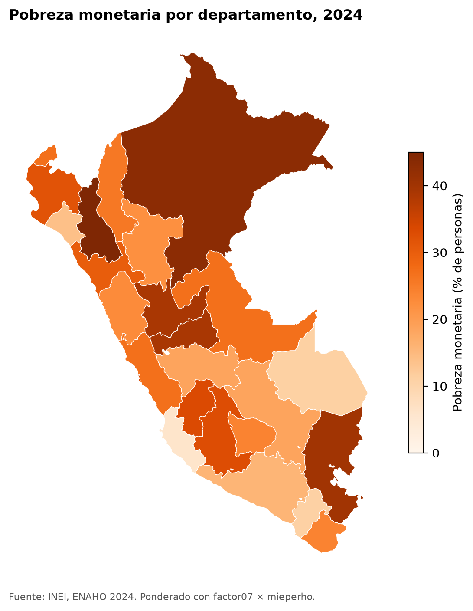

# Skills para la ENAHO

Cuatro skills de Claude Code que descargan, limpian, grafican y mapean la
pobreza monetaria de la ENAHO del INEI. Clonas el repositorio, le pides a Claude
«un mapa de la pobreza por departamento» y te devuelve el mapa con la cifra
oficial replicada.



## Las cuatro skills

Cada una hace una cosa y le pasa su salida a la siguiente. Si falta lo que
necesita, llama primero a la anterior: un solo pedido puede activar varias.

| Skill | Recibe | Entrega |
|---|---|---|
| `descargando-enaho` | Un año | `datos/<código>-Modulo34/` y `datos/<código>-Modulo02/`, bajados del portal de microdatos del INEI |
| `limpiando-enaho` | Los `.dta` de `datos/` | `salidas/hogares_<año>.parquet`, `salidas/personas_<año>.parquet` y `salidas/validacion.txt` |
| `graficando-enaho` | La base limpia y una pregunta: área, dominio, departamento, sexo o edad | `figuras/*.png` |
| `mapeando-enaho` | La base limpia y los límites de los 25 departamentos | `mapas/pobreza_departamento_<año>.png` |

Cada skill vive en `.claude/skills/<nombre>/`, con su `SKILL.md` (las
instrucciones para Claude) y su script en `scripts/`.

## Cómo usarlo

Necesitas [uv](https://docs.astral.sh/uv/) y [Claude Code](https://claude.com/claude-code).

```bash
git clone <url-de-este-repositorio>
cd skills-enaho
uv sync
claude
```

Dentro de Claude, pide en tus palabras:

- «¿Cuál fue la pobreza en Cusco en 2024?»
- «Grafica la pobreza urbana y rural»
- «Haz un mapa de la pobreza extrema por departamento con la ENAHO 2023»

La primera vez, Claude baja unos 20 MB del INEI y limpia la base, lo que toma
menos de un minuto. Si el año no está indicado, usa 2024.

También puedes correr los scripts sin Claude, en este orden:

```bash
uv run .claude/skills/descargando-enaho/scripts/descargar.py --anio 2024
uv run .claude/skills/limpiando-enaho/scripts/limpiar.py --anio 2024
uv run .claude/skills/graficando-enaho/scripts/graficar.py --por area --anio 2024
uv run .claude/skills/mapeando-enaho/scripts/mapear.py --anio 2024
```

## Cómo sabemos que la base está bien limpia

Porque replica la cifra oficial del INEI. `salidas/validacion.txt` de 2024:

| Cifra | INEI | Esta base |
|---|---|---|
| Pobreza monetaria | 27.6 % | 27.58 % |
| Pobreza extrema | 5.5 % | 5.50 % |
| Hogares en la sumaria | 33,691 | 33,691 |
| Residentes habituales | 108,664 | 108,664 |

Si la pobreza difiere de la oficial en más de 0.1 puntos, el script se detiene y
Claude no usa la base. La validación conoce la cifra oficial de 2019, 2022, 2023
y 2024.

## Por qué hay dos bases

El INEI calcula la pobreza con la sumaria, pesando cada hogar por
`factor07 × mieperho`. Con la base de personas ponderada por `facpob07` sale
27.53 % y no 27.58 %, porque los residentes del módulo de miembros no son
exactamente los `mieperho` de cada hogar.

- **Pobreza por territorio** (total, área, dominio, departamento): `hogares_<año>.parquet`. Replica al INEI.
- **Pobreza por sexo o edad**: `personas_<año>.parquet`. Esas variables solo existen por persona.

## Las trampas que las skills ya resuelven

- **Ceros a la izquierda.** `conglome` y `ubigeo` son texto: `"010101"`, no `10101`.
- **Nombres rotos.** La columna del año llega como «aÑo» y se renombra a `anio`.
- **No todos son residentes.** El módulo de miembros tiene 117,721 filas; los residentes habituales son 108,664.
- **Uniones que duplican.** Cada unión usa `validate` para fallar en vez de multiplicar filas.
- **Encuestas no son personas.** Toda cifra va ponderada: 33,691 hogares representan 34.5 millones de personas.
- **Códigos, no números.** `pobreza` vale 1, 2 o 3; pobre es `pobreza <= 2`, nunca un promedio.
- **Mapas por código.** Se une `ubigeo[:2]` con `FIRST_IDDP`, nunca por nombre, y Lima (15) y Callao (07) van separados.

## Evaluación

Corrimos tres pedidos con y sin skills. Con skills, los tres dieron la cifra
correcta y validada, y las figuras siguieron las reglas. Sin skills, Claude no
encontró la cifra de Cusco y las figuras salieron cada una con su propio estilo.
Detalle en [evaluacion.md](evaluacion.md).

## Estructura

```
.claude/skills/
  descargando-enaho/   SKILL.md + scripts/descargar.py
  limpiando-enaho/     SKILL.md + reference.md + scripts/limpiar.py
  graficando-enaho/    SKILL.md + scripts/graficar.py
  mapeando-enaho/      SKILL.md + scripts/mapear.py
datos/                 zip, .dta y GeoJSON (no se suben a GitHub)
salidas/               bases limpias (.parquet, no se suben) y validacion.txt
figuras/               gráficos PNG
mapas/                 mapas PNG
evaluacion.md          los tres pedidos con y sin skills
```

## Fuentes

- Microdatos: INEI, Encuesta Nacional de Hogares (ENAHO), módulos 34 y 02.
  [proyectos.inei.gob.pe/microdatos](https://proyectos.inei.gob.pe/microdatos/)
- Límites departamentales: `peru_departamental_simple.geojson`, del repositorio
  [d2cml-ai/Data-Science-Python](https://github.com/d2cml-ai/Data-Science-Python).
